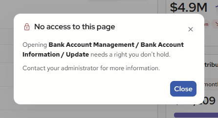

# Widget permissions: how the old system decides, and what V2 should do

Draft for review, 16 October 2026. Written from the legacy code in `C:\Users\ocurran\source\repos\MBAccounting`
(read-only; file and line references are to that repository) and the V2 handover. One section per widget,
old system first, then the V2 recommendation. After review, the summary table in section 7 becomes the
permissions list for Value Labs.

The question for each widget is the same: **which Task Role right shows the widget, which right lets a
user act inside it, and what does a user without the right see.**

---

## 1. How the old system decides

**The Task Role editor.** Security Setup, Task Roles, Update: pick a module on the left (Accounts Payable,
Accounts Receivable, Bank Account Management, Deposits On Hand, Donors And Gifts, Fixed Assets, General
Ledger, Insurance Billing, Loan Processing, Payroll, Pension Billing, Purchasing Management, Remittance,
...); on the right a tree of tasks, each with an Inquiry box, a Full Rights box, or both. The first row under
every module is **"Dashboard"**, with a Full Rights box only.

**What the Dashboard row is.** It is not a separate right. It is the module's **root task**, whose page is the
bare module path: `/AccountsPayable`, `/Payroll`, `/GeneralLedger` and so on. The rows are seeded in three
tables, `SS_Page` (the URI), `SS_Task` (module, sequence, name, Allow Update, Allow Inquiry) and
`SS_ScreenSectionTask` (the editor's labels), in `Plugin\sql\Archive\1000_CreateDB.sql:5644, 5675` and
`1001_DefaultData.sql:2010-2021, 2350-2453` with later modules in `1009_V4.sql`, `1015_V5.sql`,
`1018_V7.sql`, `1021_V8.sql`, `1041_V89.sql`. Root tasks are seeded with Allow Inquiry off, which is why the
row shows only a Full Rights box. Granting the Dashboard row grants the module's home page and everything
else that tests the bare module path.

**How a right is tested.** `ShelbyContext.Allowed(uri, level)` (`Shelby.Data\ShelbyContext.cs:761-775`):
- the user's tasks are the union of their roles' rows (`:887-904`); an Admin user holds every task at
  Update (`:871-884`); the list is then limited to licensed modules (`:907-952`);
- the match is an **exact, case-insensitive match on the URI**: holding `/Payroll` does not grant
  `/Payroll/EmployeeInformation/SecureTimeOffHoursTab`, nor the reverse;
- two levels: **Inquiry** (any granted row passes) and **Update** (the row's Allow Update flag);
- every page checks its own URI at Inquiry when it loads (`Shelby.Web.UI\ShelbyPage.cs:487-490`); a
  failed check redirects with "You do not have access to {task}." / "Access Denied".

**How the dashboard uses it** (`Shelby.Web.UI\DataPanelControl.cs`):
- each panel declares one access URI in its class attribute;
- the "add a panel" list contains only panels whose URI the user holds at Inquiry, plus panels with no URI
  (`:185-192`);
- a panel already on the dashboard whose right is later removed keeps its header and hides its body; no
  message (`:154-163`).

So the owner's idea, "find each widget's module and connect it to that module's Dashboard right", is exactly
how the old dashboard already works for thirteen of the seventeen widgets. The exceptions are listed under
their widgets below: Payroll Scheduled Time Off (its own task under Payroll), My Status and Main Content
Tasks (no module right; each query or tile carries its own) and Financial KPI (new, no old panel).

**The V2 rule proposed throughout.** A widget is offered when the user holds its module's Dashboard right
(the bare module URI at Inquiry), exactly as today. Actions inside a widget need the right the real page
checks for that action. A user without the widget's right is not offered it; if the widget is already placed
and the right is removed, the card shows "You do not have access to {module}" instead of the old blank body.
The API enforces the same checks; the widget's hiding is presentation only.

---

## 2. Widget by widget

Each section: the module and its Dashboard row; what the old panel tests; what V2 adds; the recommendation;
anything open.

### 2.1 Budget Compared to Actual
- **Module / row**: General Ledger, "Dashboard" (root task `/GeneralLedger`, Full Rights only).
- **Old panel**: `/GeneralLedger` at Inquiry (`DataPanelControls\BudgetComparedToActual.ascx.cs:19`). Inside,
  the Special Report accounts option shows only with `/GeneralLedger/Reports/SpecialReports` at Inquiry
  (`:154-155`).
- **V2 adds**: interval buttons, sparkline, compare menu, a drill pop-up; no write actions.
- **Recommendation**: show on the General Ledger Dashboard right. Keep the Special Reports sub-right for
  the special-report lines in the pop-up and the compare menu. No other right.

### 2.2 Pension Plans
- **Module / row**: Pension Billing, "Dashboard" (`/PensionBilling`).
- **Old panel**: `/PensionBilling` at Inquiry (`PensionPlans.ascx.cs:17`); no other check.
- **V2 adds**: district filter, per-plan drill to appointees; no write actions.
- **Recommendation**: show on the Pension Billing Dashboard right. No other right.

### 2.3 Payroll Distributions
- **Module / row**: Payroll, "Dashboard" (`/Payroll`).
- **Old panel**: `/Payroll` at Inquiry (`PayrollDistributions.ascx.cs:14`). Totals are grouped by compensation
  distribution; no employee-level pay is shown. The repository joins every employee of the tenant, so
  **Secure employees' pay is inside the totals**; the `/Payroll/Secure/Employee` filter is not applied.
- **V2 adds**: the Employee Break Down (individual pay) and its export.
- **Decided already** (decisions page Q7): users whose role has the Payroll Dashboard permission see the
  break down; everyone else sees the section hidden and the export without employee rows.
- **Recommendation**: show on the Payroll Dashboard right; the Employee Break Down and its employee rows on
  the same right, as decided. **Open**: whether Secure employees should be excluded from the break down for
  users without `/Payroll/Secure/Employee`; the old panel never had to answer this because it showed no
  individuals.

### 2.4 Remittance Pledges
- **Module / row**: Remittance, "Dashboard" (`/Remittance`).
- **Old panel**: `/Remittance` at Inquiry (`RMPledges.ascx.cs:13`); no other check.
- **V2 adds**: member-church drill, info controls; no write actions.
- **Recommendation**: show on the Remittance Dashboard right. No other right.

### 2.5 Receivable Invoices Outstanding
- **Module / row**: Accounts Receivable, "Dashboard" (root task on page 10). The page was seeded as
  `/Financials/AccountsReceivable/Home` (`Plugin\sql\Archive\1001_DefaultData.sql`), changed to
  `/Financials/AccountsReceivable` (`Archive\1006_V3DataUpdate.sql`), then to `/AccountsReceivable` by the
  move-to-root script (`2007_MoveToRoot.sql:45-51`). So the Dashboard row carries `/AccountsReceivable`.
- **Old panel**: tests `/AccountsReceivable` at Inquiry (`ReceivableInvoicesOutstanding.ascx.cs:18`), the same
  string as the Dashboard row. No other check.
- **V2 adds**: aging bands, customer drill, "Open invoice". The invoice page is
  `/AccountsReceivable/TransactionInquiry/Invoice/{id}` (route in `FinancialsAreaRegistration.cs:211`).
- **Recommendation**: show on the Accounts Receivable Dashboard right. "Open invoice" needs
  `/AccountsReceivable/TransactionInquiry` at Inquiry; hide the link without it. Contact details on an
  expanded invoice follow the same right.

### 2.6 Insurance Billing Plans
- **Module / row**: Insurance Billing, "Dashboard" (`/InsuranceBilling`).
- **Old panel**: `/InsuranceBilling` at Inquiry (`InsuranceBillingPlans.ascx.cs:16`); no other check.
- **V2 adds**: sorting, an info icon; no write actions.
- **Recommendation**: show on the Insurance Billing Dashboard right. No other right.

### 2.7 Deposits on Hand
- **Module / row**: Deposits On Hand, "Dashboard" (`/DepositsOnHand`).
- **Old panel**: `/DepositsOnHand` at Inquiry (`DepositAccounts.ascx.cs:15`); no other check.
- **V2 adds**: compare-to menu, trend, per-type pop-up, "Open account"; no write actions.
- **Recommendation**: show on the Deposits On Hand Dashboard right. "Open account" needs the deposit
  account page's own URI at Inquiry; hide without it.

### 2.8 My Status
- **Module / row**: none; the panel has no access URI (`MyStatus.ascx.cs:18`).
- **Old panel**: each query carries its own module path and is kept only if the user holds it at Inquiry
  (`MyStatus.ascx.cs:58`); the Payroll queries use `/Payroll`, others `/AccountsPayable`, `/GeneralLedger`,
  `/BankAccountManagement`, `/PurchasingManagement` (`Shelby.Repository\Queries\MyStatusQueries\*.cs`).
- **V2 adds**: nothing (built as V1).
- **Recommendation**: always offered; each query shown only with its module's Dashboard right, as today.

### 2.9 Payroll Scheduled Time Off
Treated in full in section 4. In short: show on `/Payroll/EmployeeInformation/SecureTimeOffHoursTab` at
Inquiry, not the Payroll Dashboard row; rows narrowed to the signed-in employee's approval departments;
Approve and Undo on the same right at Update, which the old panel did not check.

### 2.10 Loans With Balance Due
- **Module / row**: Loan Processing, "Dashboard" (`/LoanProcessing`).
- **Old panel**: `/LoanProcessing` at Inquiry (`LoansWithBalanceDue.ascx.cs:13`); no other check.
- **V2 adds**: pie and bands, loan pop-up, "Open loan", Export to Excel. Loan page
  `/LoanProcessing/LoanInformation/Update` (read-only without Update, `:26`).
- **Recommendation**: show on the Loan Processing Dashboard right. "Open loan" needs
  `/LoanProcessing/LoanInformation` at Inquiry; hide without it. Export follows the widget's right.

### 2.11 Fixed Asset Values
- **Module / row**: Fixed Assets, "Dashboard" (`/FixedAssets`).
- **Old panel**: `/FixedAssets` at Inquiry (`FixedAssets.ascx.cs:17`); no other check.
- **V2 adds**: groupings, chart, class pop-up, Export to Excel, open asset. Asset page
  `/FixedAssets/AssetInformation/Update`.
- **Recommendation**: show on the Fixed Assets Dashboard right. Opening an asset needs
  `/FixedAssets/AssetInformation` at Inquiry; hide without it.

### 2.12 Purchasing Management
Treated in full in section 3. In short: show on `/PurchasingManagement` at Inquiry; the two Awaiting options
already limit themselves to the user's level; Approve and Reject need the user on the request's path at the
level that acts (or the Approval Override right at Update); Hold needs the user on the path; "Open request"
needs `/PurchasingManagement/Requests/Update`.

### 2.13 Main Content Tasks
- **Module / row**: none; the panel has no access URI (`MainContentTasks.ascx.cs:16`).
- **Old panel**: each tile is a task the user holds (`AllowAccess` from the user's tasks,
  `SSScreenSectionTaskRepository.cs:120`; filter at `MainContentTasks.ascx.cs:31`); a licence check removes
  the Statistics tile without the Remittance licence (`:28-29`).
- **V2 adds**: My Tasks list and background panels; built as V1 otherwise.
- **Recommendation**: always offered; each tile shown only when the user holds that task, as today. My Tasks
  can only contain tasks the user holds.

### 2.14 Bank Balances
- **Module / row**: Bank Account Management, "Dashboard" (`/BankAccountManagement`).
- **Old panel**: `/BankAccountManagement` at Inquiry (`BankBalances.ascx.cs:16`). Inside, the account list is
  filtered by the user's **GL account roles** (include or omit by company, region, fund, department and
  account range, `BRBankAccountRepository.cs:92-130`); with no accounts the dropdown is hidden (`:77-78`).
- **V2 adds**: bars, twelve-month line, drill, "Open in Bank". **The old panel never linked anywhere**
  (`BankBalances.ascx` and its code-behind contain no hyperlink or redirect), so the question of what
  right the link needs is new to V2.
- **Is the Dashboard right enough to open the bank page? No** (owner's question, 19 Oct). Every page
  load is gated on the page's own URI at Inquiry (`ShelbyPage.cs:487`, `NotAllowedRedirect()` on
  failure), and `Allowed()` is an **exact, case-insensitive match** on the task's page URI with only the
  root and `/portal` exempt (`ShelbyContext.cs:761-775`). There is no prefix match and nothing is
  inherited from the module row. Holding `/BankAccountManagement` grants that page and nothing else.
- **What "Open in Bank" needs**: the drill opens
  `/BankAccountManagement/BankAccountInformation/Update`, so the user must hold that page's row at
  Inquiry. The row sits under **Modify** in the Task Role editor's Bank Account Management tree (see
  the Permissions view's screenshot). Whether `Default` and `Update` under `BankAccountInformation` are
  one task row or two is in the seed table, not the repository.
- **Inside the page, more rights again**: `Update.aspx.cs:1013-1022` (`SetSecurity`) hides the account
  number field and seven tabs (Company Info, MICR, Images, MICR Password, ACH, AP Checks, PR Checks)
  unless the user holds `/BankAccountManagement/BankAccountInformation/Secure<Name>` at **Update**
  (Full Rights, not Inquiry). A user who can open the page may still see most of it missing.
- **Recommendation**: show the widget on the Bank Account Management Dashboard right; **the
  account-role filter must be kept in the API** (it is data access, not a widget right). "Open in
  Bank" is **always shown**; a click by a user without
  `/BankAccountManagement/BankAccountInformation/Update` at Inquiry opens the no-permission pop-up
  naming **Bank Account Management / Bank Account Information / Update** (owner's rule, 19 Oct, see
  5.2). The Dashboard right does not confer that page. V2 need not model the `Secure*` rights: the
  destination page applies them itself.

### 2.15 Accounts Payable By Due Date
- **Module / row**: Accounts Payable, "Dashboard" (`/AccountsPayable`).
- **Old panel**: `/AccountsPayable` at Inquiry (`AccountsPayableByDueDate.ascx.cs:17`); the repository only
  filters to the context bank account (`:195`).
- **V2 adds**: tiles, search, invoice pop-up with "Open in Accounts Payable" and "Schedule payment", vendor
  pop-up. Invoice page `/AccountsPayable/TransactionInquiry/Details/{id}` (Inquiry to view, Update to edit,
  `Transactions\Update.aspx.cs:1755`). **AvidXchange is not a right**: it is the tenant feature flag
  `AvidPaySp` (`FeatureTypeEnum:23`, `FeatureRepository.cs:29-36`), and the bank account must be
  Avid-approved (`Transactions\Update.aspx.cs:699`).
- **Recommendation**: show on the Accounts Payable Dashboard right. "Open in Accounts Payable" needs
  `/AccountsPayable/TransactionInquiry` at Inquiry. "Schedule payment" shows only when the AvidPay feature
  is enabled for the tenant **and** the user holds `/AccountsPayable/PaymentProcessing` at Update; otherwise
  the pop-up's note explains it is not enabled.

### 2.16 Gifts Pledges
- **Module / row**: Donors And Gifts, "Dashboard" (`/DonorsAndGifts`).
- **Old panel**: `/DonorsAndGifts` at Inquiry (`GiftsPledges.ascx.cs:11`); no other check.
- **V2 adds**: gifts outside a pledge, the ledger pop-up, "Open in Gifts and Pledges". Pledges page
  `/DonorsAndGifts/Pledges`; editing a pledge needs `/DonorsAndGifts/Pledges/Update` (`AddPledge.aspx.cs:21`).
- **Recommendation**: show on the Donors And Gifts Dashboard right. "Open in Gifts and Pledges" needs
  `/DonorsAndGifts/Pledges` at Inquiry; hide without it.

### 2.17 Financial KPI
- **Module / row**: none; new in V2, no old panel.
- **Old panel**: none.
- **V2 adds**: the whole band: income, expenses and net income, current and prior fiscal year to date, all
  general ledger totals, with info tooltips and a refresh. No write actions.
- **Options**: (a) the General Ledger Dashboard right, the same as Budget Compared to Actual, since every
  figure is a ledger total and nobody who may not see the ledger should see net income; (b) a new task under
  General Ledger, "Financial KPI", so a Task Role can give leadership the band without the rest of the ledger.
- **Recommendation**: (a) for the first release; (b) is a seed-table addition that can follow if a customer
  asks. **Open for the owner.**

---

## 3. Purchasing Management in full

**Old panel** (`DataPanelControls\PurchasingManagement.ascx.cs`): shown on `/PurchasingManagement` at Inquiry
(`:19`). The Select options already limit themselves: "Awaiting my approval next" and "Awaiting my approval"
show only requests where the user is on the path or created the request (`:92-98`); "Unapproved" and
"Approved", and the approval-path list, show a request when its path has no users, or the user is a path
user, or the user is Admin, or the user holds `/PurchasingManagement/Requests/ApprovalOverride` at Update
(`:101-112, 130-133`). The panel has no actions; its pencil opens the request page.

**The request page** (`PurchasingManagement\Requests\Update.aspx.cs`, URI `/PurchasingManagement/Requests/Update`):
- opening needs the page URI at Inquiry; editing the header needs it at Update (`ShelbyPage.cs:252, 487`);
- if any line's account is outside the user's account roles: "You do not have access to an account associated
  with this order." (`:159-174`);
- the path list offers paths with no users or that include the user, unless the user holds Approval Override
  at Update (`POApprovalRepository.cs:45-46`); with none: "You do not have access to any approval paths so you
  cannot enter a request." (`:188-193`);
- in the Approvals grid (`Content\scripts\Controls\POApprovalsGrid.js:65-93`) Approved and Rejected can be
  ticked only on the user's own row at the current level, or anywhere with Approval Override; Hold has no
  such lock;
- Admin is **not** a shortcut on this page (only the panel's list uses it).

**The email approve page** (`Requests\ApproveReject.aspx.cs`, `/PurchasingManagement/Requests/Approve|Reject/{id}`):
the user must be on the path ("You are not required to approve this order.", `:112`); the account-role check
applies (`:170-173`); Approval Override is not consulted; `ApproveRejectOrder` enforces the path again
server-side (`POOrderRepository.cs:903-907`).

**What V2 does that the panel did not**: the table lists every request the user may see with whose turn it
is; the pop-up shows the request read-only and offers Approve, Hold and Reject; "Open request" links to the
page; Encumbrances follows the same filters.

**Recommendation**
| Part of the widget | Right | Without it |
|---|---|---|
| The widget itself, table, Encumbrances, pop-up (read) | `/PurchasingManagement` at Inquiry (the module's Dashboard row) | not offered; "You do not have access to Purchasing Management" if already placed |
| Rows the user may see | as the panel: own level or own requests for the two Awaiting options; for All, Unapproved and Approved a request whose path has no users, or the user is a path user, or holds Approval Override at Update | the request is not listed |
| Approve, Reject | the user is on the request's path at the level that acts now, or holds `/PurchasingManagement/Requests/ApprovalOverride` at Update; the request's accounts are inside the user's account roles | buttons absent; the footer says whose turn it is |
| Hold, Remove hold | the user is on the request's path (any level, as the page) | button absent |
| Open request | `/PurchasingManagement/Requests/Update` at Inquiry (Update to edit there) | link absent |
| Attachments, Open a file | the widget's right; the file itself is served by the request page's right | Open absent |
| Note, Save note | `/PurchasingManagement/Requests/Update` at Update | note read-only |

**Kept the same as the original panel.** The list rule is the panel's,
Admin shortcut included (a request whose path has no users, or the user is a path user, or the user is an
Admin, or holds Approval Override at Update). Approve, Hold and Reject follow the request page's rule, the only
rule the old system has for acting: on the path at the acting level, or Approval Override at Update, for
Approve and Reject; on the path for Hold.

**API note**: enforce the path test exactly as `ApproveRejectOrder` does, and apply the account-role check,
server-side; the widget only hides buttons.

---

## 4. Payroll Scheduled Time Off in full

**Old panel** (`DataPanelControls\PayrollScheduledTimeOff.ascx.cs`): shown on
`/Payroll/EmployeeInformation/SecureTimeOffHoursTab` at Inquiry (`:17`), **not** on the Payroll Dashboard
row. That task is the one that shows tab 5, Time Off Hours, on an employee's record
(`Payroll\EmployeeInformation\Update.aspx.cs:1559, 1569`). Then:
- the panel looks up the signed-in user's employee record in the company (`:82`); if one exists, rows are
  narrowed to the home departments in that employee's **"Can Approve Home Depts"** list, stored in
  `PR_EmployeeTimeOffApproval` (employee, home department), edited on the employee record
  (`Update.aspx:247`, saved `:2086-2100`) (`:83-84`);
- **a user with no employee record is not filtered and sees every time-off row in the company**;
- an employee with the right but no approval departments sees an empty grid;
- the approve boxes write the approver and date **with no further permission check** (`:164-218`);
- the same list drives the approval emails (`PREmployeeServiceController.cs:447-455`), and the portal page
  `/Portal/Payroll/ApproveTimeOff` needs that URI at Update in the menu (`MainNavigation.ascx.cs:93`).

**What V2 does**: the Approval Queue and Leave Calendar at three sizes, department and pay-group filters,
Approve with a confirmation and Undo, person info and day pop-ups.

**Recommendation**
| Part of the widget | Right | Without it |
|---|---|---|
| The widget itself | `/Payroll/EmployeeInformation/SecureTimeOffHoursTab` at Inquiry | not offered; "You do not have access to Time Off" if already placed |
| Departments listed | the signed-in employee's "Can Approve Home Depts" list | an employee with none sees the empty state "No departments to approve" |
| A user who is not an employee | every department is listed, as the panel does (kept as the original) | n/a |
| Approve, Undo | the widget's right only, no separate Update check (kept as the original) | n/a |
| Person info, day pop-up | the widget's right | n/a |

**API note**: the departments filter and the Update check both belong in the API; a non-employee's access
should follow the Q21 ruling, not the old panel's accident.

---

## 5. Links that leave the widget

Checked on 16 October: every old panel for a link, button or redirect that takes the user to another page,
then every V2 widget for the same. This matters because rights are an **exact match on the page URI**: a
module's Dashboard right does not grant the module's pages, so a link out of a widget can land on
"Access Denied" unless the destination's own right is checked first.

### 5.1 The old panels

| Panel | Leaves the panel? | Where to | How the old system guards it |
|---|---|---|---|
| Purchasing Management | Yes: a pencil on every row | `/PurchasingManagement/Requests/Update/{orderID}` (`PurchasingManagement.ascx:57`) | Not guarded on the panel. The request page checks its own URI at Inquiry on load (`ShelbyPage.cs:487`); a user with the Dashboard right but not the Requests page gets "You do not have access to {task}." |
| My Status | Yes: "Jump To Url" (pencil) per query row | one module page per query: `/AccountsPayable/TransactionInquiry`, `/AccountsPayable/PaymentProcessing`, `/AccountsPayable/RecurringPayments`, `/AccountsPayable/CreditCard/Transactions`, `/Payroll/EmployeeInformation`, `/Payroll/EarningsInquiry`, `/Payroll/Reports/EmployeeEarnings`, `/Payroll/ManualChecks`, `/GeneralLedger/UnpostedJournals`, `/GeneralLedger/ChartOfAccounts`, `/BankAccountManagement/Transactions`, `/PurchasingManagement/Requests` (`Shelby.Repository\Queries\MyStatusQueries\*.cs`, `GetUrl`) | The query is shown only with its module root at Inquiry (`MyStatus.ascx.cs:58`); the destination page then checks its own URI. So the module right shows the row and the page right decides the landing. |
| Main Content Tasks | Yes: every tile is a link | the task's own page (`MainContentTasks.ascx:6`, `SSPageNavigation.Uri`) | Tiles are only the tasks the user holds (`AllowAccess`, `MainContentTasks.ascx.cs:31`), so the destination right is checked before the tile shows. The right model for V2. |
| Quick Links | Yes: every link | the link's URI (`QuickLinks.ascx:8`) | Each link kept only with its URI at Inquiry (`QuickLinks.ascx.cs:184-199`). Same model. |
| Receivable Invoices Outstanding | No navigation. The expanded invoice uses a drill-down control borrowed from General Ledger (`ReceivableInvoicesOutstanding.ascx:3`, `GeneralLedger\PostedJournals\DrillDownControls\ARInvoiceDetail.ascx`) inside the panel | same page | The panel's own right. Cross-module code, not a cross-module link. |
| Budget Compared to Actual, Pension Plans, Payroll Distributions, Remittance Pledges, Insurance Billing Plans, Deposit Accounts, Payroll Scheduled Time Off, Loans With Balance Due, Fixed Assets, Bank Balances, Accounts Payable By Due Date, Gifts Pledges | No | - | - |

So in the old system only four panels leave the dashboard, and two of them (Main Content Tasks, Quick Links)
already check the destination right before showing the link. Purchasing Management's pencil and My
Status's jump rely on the destination page refusing the user.

### 5.2 The V2 widgets, and where to be careful

Rule for every outbound control (owner, 19 October, replacing the earlier proposal to hide the
control): **always show it.** If the user does not hold the destination page's right, the click
opens a pop-up that says so and **names the page as Module / Section / Page**, so they know exactly
what to ask for. The widget is still shown only on its module's Dashboard right, and the destination
page still enforces its own right on arrival (`ShelbyPage.cs:487`), so nothing becomes reachable that
was not; the user is told why instead of finding the control missing. The API that serves the widget
should still return, per record, whether the current user may open it, so the pop-up can be shown
without a round trip.

#### The no-permission pop-up (decided 19 October)

Three options were mocked up; the owner chose the second, with two changes: **Close is the only
control**, and the last line reads **Contact your administrator for more information.** The pop-up
is the shell's own `.modal`, title icon, close control and `.btn` family on Pathway tokens, so it needs
no new styling. Mock-up: `_tools/one-off/shoot-noaccess-mocks-2026-10-19.js`.

*Title: No access to this page. Body: Opening Module / Section / Page needs a right you don't hold.*
*Then: Contact your administrator for more information. One button, Close.*

The page is named as **Module / Section / Page**, the path the Task Role editor uses, so the user and
their administrator read the same words. Example: **Bank Account Management / Bank Account
Information / Update**.

| V2 widget | Outbound control in the build today | Destination and right to test | Care point |
|---|---|---|---|
| Purchasing Management | "Open request" (pop-up header); "Open" on each attachment; Export to Excel | `/PurchasingManagement/Requests/Update` at Inquiry; attachments are served by that page's right | The widget's own right (`/PurchasingManagement`) does **not** include the Requests page. Approve, Hold and Reject are not links; they are API actions with the path test (section 3). |
| Gifts Pledges | "Open in Gifts and Pledges" (ledger footer); the ledger's Excel file | `/DonorsAndGifts/Pledges` at Inquiry | Different page from the module root. The Excel file is built in the browser from data the user already sees; no extra right. |
| Remittance Pledges | "Open in Remittance" (member-church drill); Export to Excel | the Remittance pledge page at Inquiry (`/Remittance/...`, to name exactly when the route is confirmed) | Same pattern as Gifts. |
| Bank Balances | "Open in Bank" (account drill) | `/BankAccountManagement/BankAccountInformation` at Inquiry | Plus the GL **account roles**: a user may hold the page right and still be refused an account they may not see; the API must apply the account filter to the link as well as the list. |
| Accounts Payable By Due Date | "Open in Accounts Payable" (invoice pop-up); "Schedule payment" when AvidPay is on (Jo's version, not yet in the build) | `/AccountsPayable/TransactionInquiry` at Inquiry; Schedule payment: AvidPay feature flag on the tenant **and** `/AccountsPayable/PaymentProcessing` at Update | Two gates on one button; show the note "not enabled for this organization" when the feature is off, hide the button when the right is missing. |
| Loans With Balance Due | "Open loan" (pop-up; placeholder today); Export to Excel (placeholder) | `/LoanProcessing/LoanInformation` at Inquiry | Destination route still to confirm (decisions page). |
| Fixed Asset Values | Export to Excel (placeholder); opening an asset was asked about in Q28 | `/FixedAssets/AssetInformation` at Inquiry if the row opens the asset | Only if Q28 is answered yes. |
| Receivable Invoices Outstanding | "Open invoice" (decisions page Q16; not in the build yet); Export to Excel | `/AccountsReceivable/TransactionInquiry` at Inquiry | Build the link only with the right; the contact details shown on an expanded invoice stay under the widget's right. |
| Deposits on Hand | "Open account" (Q20; not in the build yet) | the deposit account page at Inquiry (route to confirm) | As above. |
| Payroll Distributions | Export to Excel | no page; a data permission | All or nothing: the Payroll Dashboard right shows the widget, the Employee Break Down and the export in full; nothing further is checked. |
| Pension Plans | Export as CSV, PDF, Excel | no page | Data the user already sees; no extra right. |
| My Status | Query rows navigate to the module page (as the old "Jump To Url") | each query's destination page, as in 5.1 | Keep the old two-step guard, but test the **destination page** right before showing the jump, not only the module root. |
| Main Content Tasks | Tiles to pages across every module | the tile's own task | Already the right model; keep it. My Tasks may list only tasks the user holds. |
| Budget Compared to Actual, Insurance Billing Plans, Payroll Scheduled Time Off, Financial KPI | None | - | Approve and Undo on time off are API actions, not links (section 4). |

### 5.3 What V2 must be careful with, in one list

1. **Dashboard right is not page right.** Every "Open ..." control needs the destination page's URI tested
   at Inquiry, server-side, before it is shown. Six widgets have such a control today (Purchasing, Gifts,
   Remittance, Bank, Accounts Payable, Loans) and three more will (Receivables, Deposits, Fixed Assets).
2. **Record-level filters travel with the link.** Bank account roles and Purchasing account roles can refuse
   a record the page right alone would allow; the API should mark each record openable or not.
3. **Two-gate buttons.** Schedule payment needs the tenant feature flag and a right; show the note for the
   flag, hide for the right.
4. **Exports are data, not pages.** Follow the widget's right, with the one personal-data exception in
   Payroll Distributions.
5. **Approve, Hold, Reject, Undo are not links.** They are API actions with their own tests (sections 3
   and 4); hiding the button is presentation, the API refuses.
6. **Routes to confirm with Value Labs**: Remittance pledge page, deposit account page, loan page, the AR
   invoice page, so the right tested is the one the page really checks.

---

## 6. Where the old system is wrong, and V2 should not copy it

1. Time-off approvals saved with no Update check (section 4). **Kept as the original; no Update check in V2 either.**
2. A non-employee with the time-off right sees the whole company (section 4). **Kept as the original.**
3. A placed panel whose right is removed shows a blank body with no message (section 1); V2 shows a line.
4. Payroll Distributions includes Secure employees' pay in its totals with no check (section 2.3). **All or nothing: the Payroll Dashboard right shows the widget, the Employee Break Down pop-up and the
   export in full. Whether the pop-up should ever be hidden waits on feedback.**

---

## 7. Summary table for Value Labs (after review)

| Widget | Module | Right to show the widget (Inquiry) | Rights inside | Data filters inside |
|---|---|---|---|---|
| Budget Compared to Actual | General Ledger | `/GeneralLedger` | Special report lines: `/GeneralLedger/Reports/SpecialReports` | none |
| Pension Plans | Pension Billing | `/PensionBilling` | none | none |
| Payroll Distributions | Payroll | `/Payroll` | Employee Break Down and export: the same right, nothing further | none; Secure employees included |
| Remittance Pledges | Remittance | `/Remittance` | none | none |
| Receivable Invoices Outstanding | Accounts Receivable | `/AccountsReceivable` | Open invoice: `/AccountsReceivable/TransactionInquiry` | none |
| Insurance Billing Plans | Insurance Billing | `/InsuranceBilling` | none | none |
| Deposits on Hand | Deposits On Hand | `/DepositsOnHand` | Open account: the account page | none |
| My Status | none | always | each query: its module root | none |
| Payroll Scheduled Time Off | Payroll | `/Payroll/EmployeeInformation/SecureTimeOffHoursTab` | Approve, Undo: same at Update | employee's approval departments; Q21 for non-employees |
| Loans With Balance Due | Loan Processing | `/LoanProcessing` | Open loan: `/LoanProcessing/LoanInformation` | none |
| Fixed Asset Values | Fixed Assets | `/FixedAssets` | Open asset: `/FixedAssets/AssetInformation` | none |
| Purchasing Management | Purchasing Management | `/PurchasingManagement` | Approve, Reject: on the path at the acting level or `.../Requests/ApprovalOverride` at Update; Hold: on the path; Open request and Save note: `.../Requests/Update` | list rule as the panel; account roles |
| Main Content Tasks | none | always | each tile: its own task | none |
| Bank Balances | Bank Account Management | `/BankAccountManagement` | Open in Bank: `/BankAccountManagement/BankAccountInformation` | GL account roles |
| Accounts Payable By Due Date | Accounts Payable | `/AccountsPayable` | Open invoice: `/AccountsPayable/TransactionInquiry`; Schedule payment: AvidPay feature on and `/AccountsPayable/PaymentProcessing` at Update | none |
| Gifts Pledges | Donors And Gifts | `/DonorsAndGifts` | Open in Gifts and Pledges: `/DonorsAndGifts/Pledges` | none |
| Financial KPI | General Ledger | `/GeneralLedger` | none | none |

---

## 8. Decisions

**Note**

1. Financial KPI is shown with the General Ledger Dashboard right (`/GeneralLedger` at Inquiry), like Budget
   Compared to Actual. No task of its own.
2. My Status and Main Content Tasks are carried as today: My Status offers a query only when the user holds
   that query's module right (`MyStatus.ascx.cs:58`), and Main Content Tasks shows a tile only when the user
   holds the tile's task (`MainContentTasks.ascx.cs:31`). Neither widget has a module right of its own.
3. Purchasing Management keeps the original panel's list rule, Admin shortcut included; Approve, Hold and
   Reject follow the request page's rule. Section 3.
4. Payroll Scheduled Time Off keeps the original panel's behaviour: a user with no employee record sees every
   department, and Approve and Undo need the widget's right only, with no separate Update check. Section 4.
5. Links out of a widget: **always shown**; a click by a user who does not hold the destination page's
   right opens the no-permission pop-up naming the page as Module / Section / Page (section 5.2).
   Revised 19 October from the earlier decision to hide such links. The pop-up is decided: title
   "No access to this page", the page named, "Contact your administrator for more information.",
   Close as the only control.
6. Payroll Distributions is all or nothing: a user who holds the Payroll Dashboard right sees the widget,
   the Employee Break Down pop-up and the Excel export in full; Secure employees are not excluded and nothing
   inside the widget needs a further right. Whether the pop-up should ever be hidden for some users waits on
   feedback.

Nothing is open. Every widget works from the one simple right, its module's Dashboard row; the only further
checks are the links and actions in section 5.
